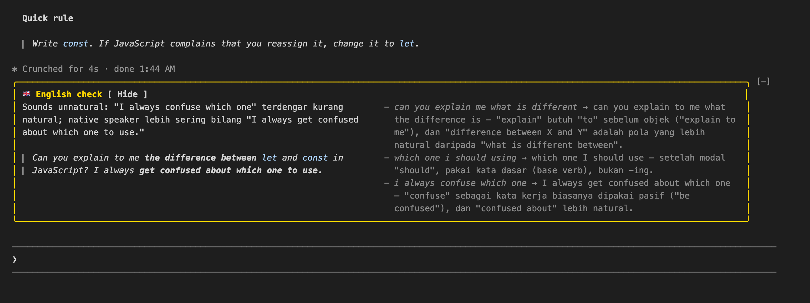
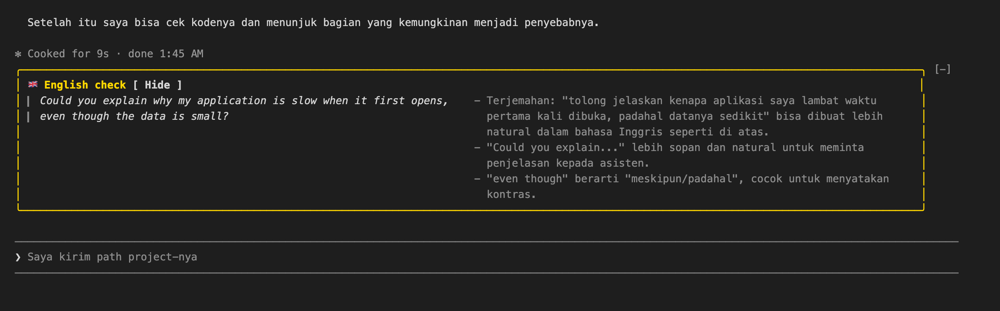
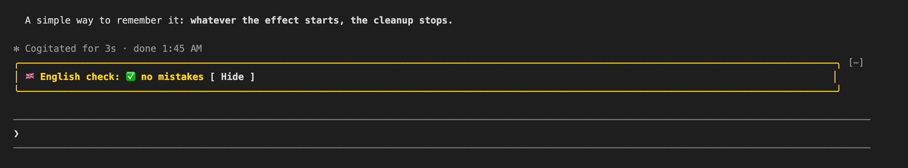

# learn-english

> **Made for native speakers of Bahasa Indonesia.** Explanations, mistake notes and word meanings are written in Bahasa Indonesia, and prompts typed in Bahasa Indonesia are translated into natural English. To coach speakers of another language, change the language named in [`coach-prompt.md`](coach-prompt.md).

A Claude Code mod for practicing English while you work. When it is on, every prompt you send is checked by Haiku (low effort) in the background, and the result shows in a sticky band above the prompt bar:

- **Left:** your message corrected, with every change in bold, or, for a message in Bahasa Indonesia, how to say it in natural English.
- **Right:** each mistake and why (explained in Bahasa Indonesia), or useful words and phrases.

Your prompt goes to the main model at once, so the answer is never delayed. Capitalization, missing apostrophes (`Im`, `dont`), code, commands, file paths and logs are never corrected.

## Examples

English with mistakes:



A prompt in Bahasa Indonesia:



Nothing to fix:



## Install

At the prompt of a Claude Code terminal session:

```
/plugin install learn-english --marketplace DXMHXR/learn-english
```

Answer `y` to add the marketplace, then press Enter to install for your user. Or from a shell:

```
claude plugin install learn-english --marketplace DXMHXR/learn-english
```

Then turn it on once:

```
/learn-english on
```

## Commands

- `/learn-english` toggles it; `/learn-english on` / `off` set it.
- `/learn-english show` shows the band again after you pressed Hide.
- `/learn-english log` lists the last 10 Haiku calls: model, effort, tokens, time and outcome.

The on/off setting and the log are kept per person and survive sessions. The commands never call the main model.

## Cost

Each check is one Haiku call of about 800 input tokens (most of it read from the prompt cache) and 100–300 output tokens: roughly $0.0002 per prompt, billed to your own Claude account or counted against your plan's usage.

## Customizing

The coaching rules live in [`coach-prompt.md`](coach-prompt.md): what to correct, what to ignore, and how to lay out the answer. The band puts list paragraphs (mistakes, phrases) on the right and everything else on the left.
